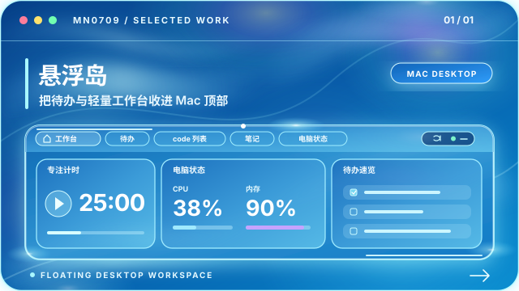
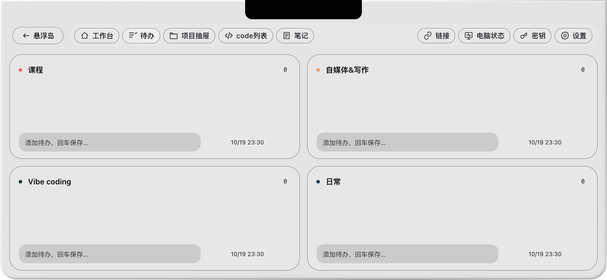
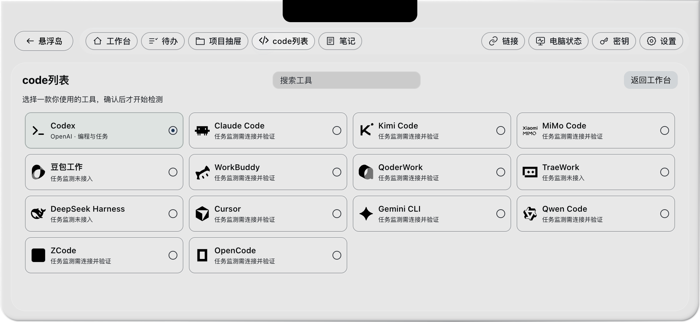
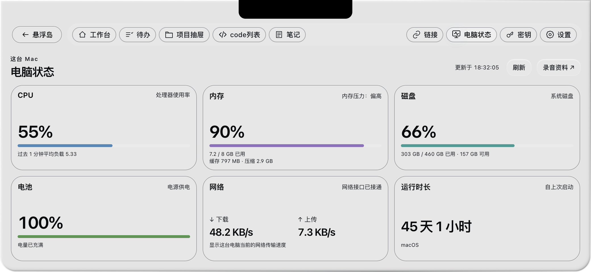

<div align="center">
  

  <h1>悬浮岛 · XuanfuDao</h1>
  <p><strong>把工作台，收在 Mac 顶部。</strong></p>
  <p>待办、AI 任务、专注计时与电脑状态，在需要时展开查看。</p>
  <p>
    <a href="#本机实图">本机实图</a> ·
    <a href="#功能与边界">功能与边界</a> ·
    <a href="#从源码运行">从源码运行</a> ·
    <a href="#来源与许可">来源与许可</a>
  </p>
</div>

> 当前源码版本 **1.5.1**，与本机检查的 `/Applications/悬浮岛.app` 版本一致。封面是按 [MN0709 主页精选项目](https://github.com/MN0709) 风格绘制的矢量设计；下方 PNG 则是 **2026-10-19 从本机悬浮岛原生窗口直接截取**，画面内没有桌面、浏览器或网页。动态数值和所选 AI 工具只反映截图当时这台 Mac 的状态。

## 本机实图

### 四类待办



四个分类可改名，分别添加任务与截止时间；到期提醒由本机应用处理。图中分类名称是这台 Mac 上的实际设置，任务列表当时为空。

### code 列表



先选定并确认一款工具，再启用对应检测。截图显示本机选择了 Codex；列表中的其他工具有各自的接入条件，**出现在列表里不等于已经连接或可以读取额度**。

### 电脑状态



此页展示当前 Mac 的 CPU、内存、磁盘、电池、网络传输和运行时长。读数随时间变化；“网络接口已接通”仅代表本机接口状态。

## 功能与边界

| 区域 | 这份 1.5.1 源码提供的能力 | 本机核查范围 |
| --- | --- | --- |
| 顶部悬浮岛与工作台 | 折叠显示状态，展开卡片式工作台；提供 AI 任务、番茄钟、快速录音、随笔记、常用指令和电脑状态入口 | 已在安装版看到折叠态及工作台界面 |
| 待办 | 四个可改名分类、截止时间和提醒 | 已在安装版看到页面；未为截图创建虚构任务 |
| code 列表 | 单选 AI 工具，区分已选、待连接和未接入 | 已在安装版看到当前 Codex 选择及各工具状态 |
| 电脑状态 | CPU、内存、磁盘、电池、网络与运行时长 | 已在安装版看到实时页面 |
| 项目抽屉 | 选择本地文件夹，搜索文件并在应用内归类；归类只改变元数据 | 已见入口与页面，尚未用有效目录完整验收文件操作 |
| 笔记、链接与外观 | 本机笔记、公开网址收藏，以及柔焦玻璃／纯黑和窗口宽度设置 | 源码与界面有对应入口；具体数据依各用户本机配置而异 |

AI 工具需要逐个满足客户端、权限、Hook 或通知配置条件。本机 Codex 页面显示了额度与任务状态；这不代表其他工具的连接已经验证。豆包工作、TraeWork、DeepSeek Harness 在当前界面明确标为任务监测未接入。录音和镜子仅在用户主动启用时请求麦克风或摄像头；剪贴板历史默认关闭。可选的语音转写、天气和网页标题抓取可能访问网络，因此不能将所有功能概括为完全离线。

## 从源码运行

当前仓库提供 **macOS 桌面端源码**，尚未在此仓库发布经验证的安装包。建议 macOS 13+、Apple Silicon、Node.js 22+，并准备 Xcode Command Line Tools 以编译原生组件。

```bash
git clone https://github.com/MN0709/xuanfudao.git
cd xuanfudao
npm ci
npm start
```

`npm test` 用于运行源码检查。项目使用 Electron、原生 HTML/CSS/JavaScript 与 macOS 原生辅助组件；`npm start` 会先编译所需原生组件。本次公开范围是桌面应用源码和经检查的本机截图；旧官网、历史截图与视频未收入仓库。

待办、笔记、链接、录音与设置主要留在当前 Mac。选择项目文件夹、连接 AI 工具或启用录音等操作，仍由使用者在本机完成。个人任务、账户凭据、工具运行缓存与安装包没有随源码上传。

## 来源与许可

这个仓库整理并展示本机使用的悬浮岛 **1.5.1** 源码。悬浮岛由 [17lijunyi/xuanfudao](https://github.com/17lijunyi/xuanfudao) 基于 [xiaopu-ai/TO-DO-Panel](https://github.com/xiaopu-ai/TO-DO-Panel) 开发；这里保留原作者和上游的署名，**不将原始开发归为 MN0709**。源码许可见 [LICENSE](LICENSE)，第三方组件与图标来源见 [THIRD_PARTY_NOTICES.md](THIRD_PARTY_NOTICES.md)。
